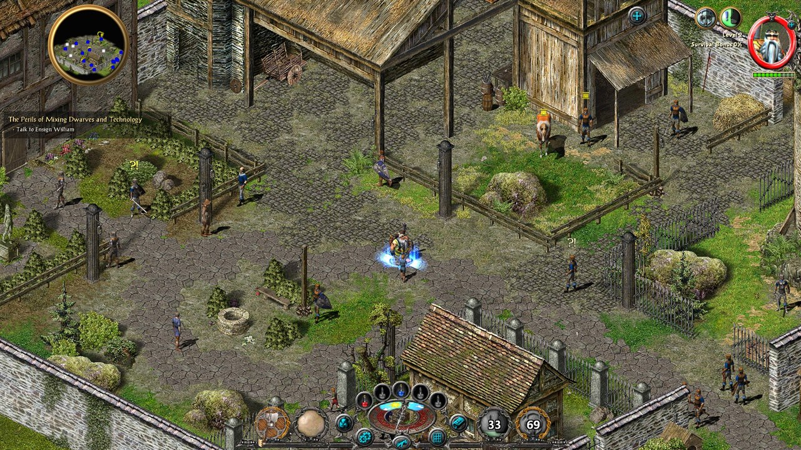
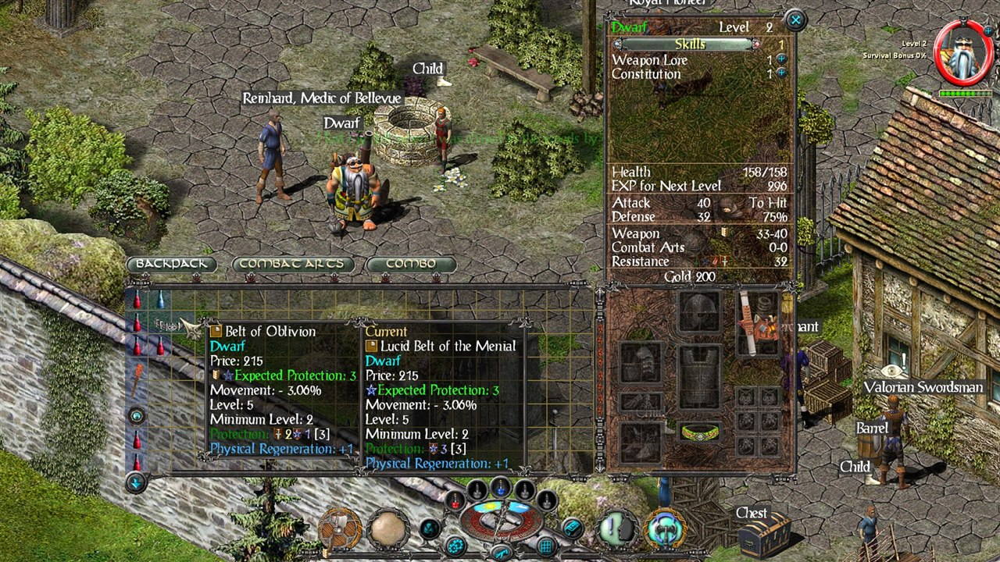
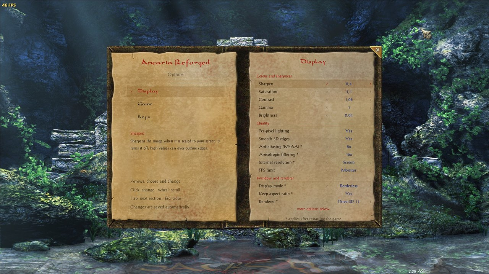
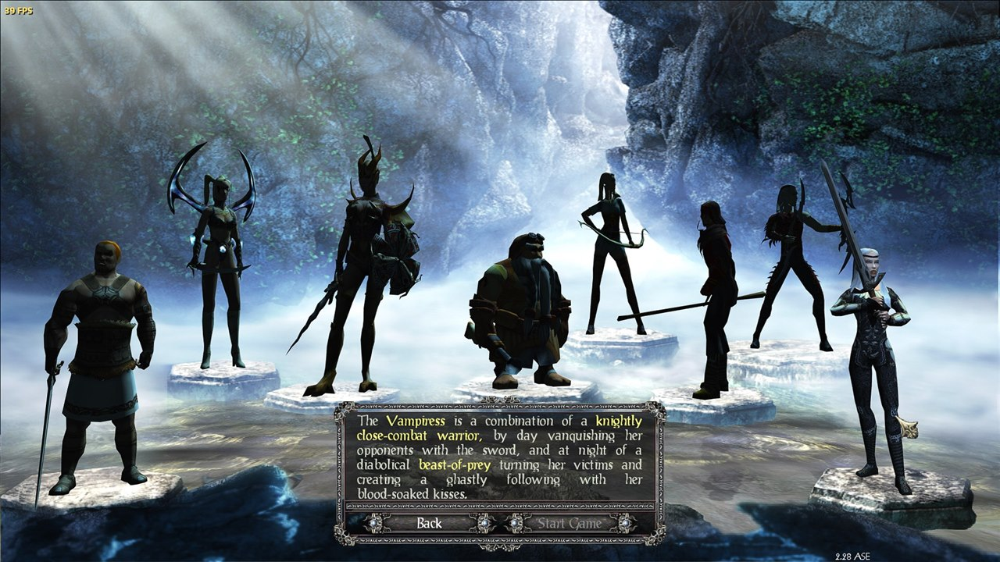
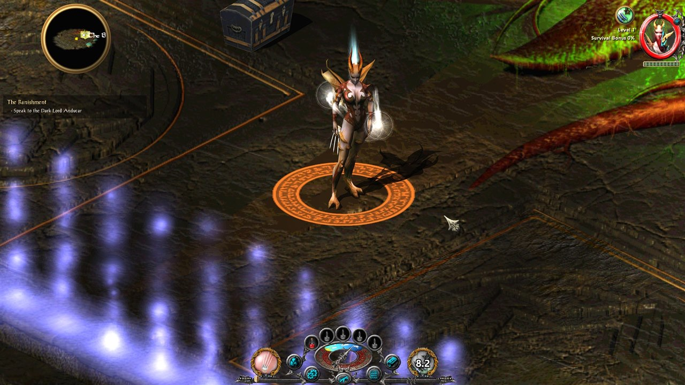
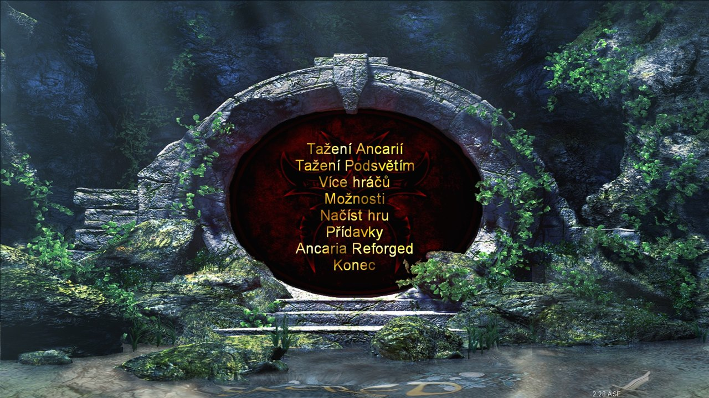

# Ancaria Reforged

**Versión / Version 0.9.2 (beta)** · **Descarga / Download:** [GitHub](https://github.com/jotatwister/Ancaria-Reforged/releases) · [Nexus Mods](https://www.nexusmods.com/sacred/mods/77)

| | |
|---|---|
|  |  |
| Panorámico, minimapa, misiones activas y nivel y supervivencia junto al retrato. *Widescreen, minimap, active quests, level and survival by the portrait.* | Al pasar el ratón por un objeto, al lado sale el que llevas equipado; letras nítidas a la resolución de la pantalla. *Hovering an item shows the one you have equipped; sharp text at screen resolution.* |
|  |  |
| El menú del mod se abre desde los propios menús del juego. *The mod menu opens from the game's own menus.* | Menú de opciones con el estilo del libro del juego, aquí en inglés. *Options menu styled like the game's book, here in English.* |
|  |  |
| Selección de personaje a pantalla completa. *Full-screen character selection.* | Underworld en panorámico. *Underworld in widescreen.* |
|  | |
| Textos del juego en otro idioma (aquí checo) con el global.res de cada versión. *Game texts in another language (here Czech) using each version's global.res.* | |

**[Castellano](#castellano)** · **[English](#english)**

---

## Castellano

Mod para **Sacred Gold** (Steam o GOG, versión 2.0.2.28 en inglés; la de GOG aún sin probar) que se instala como `ddraw.dll` (la DLL se llama SacredFix):
motor gráfico propio (Direct3D 11, con Direct3D 9 de reserva), resolución panorámica, arreglos de compatibilidad y
mejoras de calidad de vida. Escrito en C# (.NET, NativeAOT).

### Qué hace

- **Compatibilidad:** arregla cuelgues y cierres del juego original en Windows modernos (arranque, color de 16 bits,
  modos de vídeo, Alt+Tab, vídeos) y evita que la ventana se minimice al cambiar de programa.
- **Imagen:** panorámico 16:9 y ultrapanorámico 21:9, motor Direct3D 11 propio, dibujo a la resolución del monitor,
  antialiasing, filtrado anisótropo, luz por píxel, ajuste de color y modos ventana, sin bordes o pantalla completa.
- **Interfaz:** minimapa siempre visible, buffos activos con su tiempo junto al retrato, segundos de recarga,
  nivel y bonus de supervivencia, misiones activas a la izquierda, nombres de objetos fijos con Alt y filtro por
  calidad, y comparación de cada objeto con el que llevas equipado.
- **Comodidad:** el oro se recoge solo al pasar a su lado (en partida individual) y, al atacar a un enemigo, el cursor
  se queda sobre él.
- **Autocast:** las teclas de las artes (6 a 0) lanzan el arte al momento hacia el cursor, sin tener que
  seleccionarlo y pulsar el botón derecho. Las teclas del juego se pueden reasignar desde el menú.
- **Letra a elegir:** cualquier fuente instalada en Windows (o un .ttf/.otf en la carpeta `font` del juego) para los
  textos y los títulos del juego y del mod, con tamaño de 8 a 14. Las letras del juego se pintan a la resolución de la
  pantalla, nítidas también en los menús.
- **Idiomas:** los textos y las voces del juego en otro idioma (castellano, alemán, checo, polaco…) usando los archivos
  de esa versión del juego: su `global.res` en `scripts\<código>` y su `sound.pak` en `pak\<código>`. Se eligen por
  separado en el menú. El mod no reparte ningún archivo del juego.
- **Menú propio** con el aspecto del libro del juego, en castellano o inglés. Se abre con la opción
  **«Ancaria Reforged»** del menú principal o del menú de Escape.

### Lo que aporta Ancaria Reforged

- **Un motor gráfico nuevo.** El juego usaba DirectDraw y Direct3D 7, de 2004. Ancaria Reforged lo traduce todo a
  Direct3D 11 (con Direct3D 9 de reserva) sin modificar ningún archivo del juego.
- **Panorámico y ultrapanorámico.** El juego estaba hecho para 1024×768. Ahora se adapta a la forma de tu pantalla
  (16:9, 16:10 o 21:9), con más mundo a los lados, la interfaz en su sitio y los personajes y objetos bien colocados.
- **Más nítido que nunca.** La imagen y las letras se dibujan a la resolución de tu monitor (1080p, 1440p, 4K) con
  antialiasing, sin cambiar lo que se ve.
- **Tu idioma.** La versión de Steam y GOG solo trae el inglés; con los archivos de otra versión, textos y voces en tu
  idioma.
- **Arreglos de estabilidad.** Cuelgues al arrancar, cierres con Alt+Tab y con los vídeos, el color de
  16 bits en Windows modernos y los bajones de FPS en las ciudades.
- **Información que el juego no da.** Buffos activos con su tiempo, misiones en pantalla, nivel y bonus de
  supervivencia, segundos de recarga, filtros del botín por calidad y comparación con lo equipado.
- **Menos clics.** Recogida del oro al pasar, cursor sobre el enemigo atacado y autocast de las artes de combate.
- **Todo desde el propio juego.** Un menú con el estilo del libro del juego, en castellano o inglés, que explica cada
  opción, dentro de los menús del juego.

### Lo que falta

**Por probar**
- Otros equipos y monitores: 4K con escalado de Windows, 16:10, 4:3, 21:9 reales y 120/144 Hz, y Windows 7/8.
- Partidas en red (cooperativo).
- Un cuelgue al saltar los vídeos de inicio que se vio dos veces y ya no se reproduce.

**Por crear**
- Que el tamaño de letra elegido también cambie los textos del mod.

### Compilar e instalar

Requisitos: Windows 10/11, [.NET SDK 9](https://dotnet.microsoft.com/) y Visual Studio 2022 con
«Desarrollo para el escritorio con C++» (NativeAOT para x86 y el compilador de C).

Desde **«x86 Native Tools Command Prompt for VS 2022»**, en la carpeta del repositorio:

```bat
mkdir src\SacredFix\obj
cl /nologo /c /O1 /GS- /Zl /W4 src\SacredFix\Native\early.c /Fosrc\SacredFix\obj\early.obj
set "PATH=%PATH%;%ProgramFiles(x86)%\Microsoft Visual Studio\Installer"
dotnet publish src\SacredFix\SacredFix.csproj -c Release
```

El segundo paso compila el punto de entrada nativo de la DLL (`early.c`); el tercero deja que NativeAOT encuentre
Visual Studio. El resultado es `ddraw.dll`, en la carpeta `publish` dentro de `src\SacredFix\bin`.

Si solo quieres jugar, descarga el mod ya compilado de [GitHub](https://github.com/jotatwister/Ancaria-Reforged/releases) o de [Nexus Mods](https://www.nexusmods.com/sacred/mods/77).

Para instalarlo, copia `ddraw.dll` y `src\SacredFix\SacredFix.ini` en la carpeta de Sacred Gold (donde está
`Sacred.exe`). Para desinstalarlo, borra `ddraw.dll`.

La configuración está en `SacredFix.ini`, junto al juego, y casi toda se cambia en el juego desde el menú
**«Ancaria Reforged»** (menú principal o menú de Escape).

### Avisos

- Este repositorio **no contiene archivos del juego**. Hace falta una copia legal de Sacred Gold.
- No tiene relación con los autores ni con los editores de Sacred.
- Algunas direcciones del parche panorámico se tomaron como datos de
  [kirides/sacred-bild](https://github.com/kirides/sacred-bild) (GPL-3), y sus notas, junto con las de
  [Rampere-98/Sacred-Gold-ModKit](https://github.com/Rampere-98/Sacred-Gold-ModKit), ayudaron con el ultrapanorámico;
  no se usa su código.

### Licencia

[GPL-3.0](LICENSE): puedes usar, estudiar, modificar y repartir el mod; si repartes una versión modificada, su
código también tiene que publicarse con GPL-3.0. Se entrega sin garantía de ningún tipo.

---

## English

A mod for **Sacred Gold** (Steam or GOG, English version 2.0.2.28; GOG not tested yet) installed as `ddraw.dll` (the DLL is called SacredFix): its own
renderer (Direct3D 11, with Direct3D 9 as a fallback), widescreen resolution, compatibility fixes and
quality-of-life improvements. Written in C# (.NET, NativeAOT).

### Features

- **Compatibility:** fixes hangs and crashes of the original game on modern Windows (startup, 16-bit colour,
  video modes, Alt+Tab, videos) and keeps the window from minimising when you switch apps.
- **Graphics:** 16:9 widescreen and 21:9 ultrawide, custom Direct3D 11 renderer, rendering at your monitor's
  resolution, antialiasing, anisotropic filtering, per-pixel lighting, colour adjustment and windowed, borderless or
  fullscreen modes.
- **Interface:** always-on minimap, active buffs with their remaining time by the portrait, cooldown seconds,
  level and survival bonus, active quests on the left, pinned item names with Alt with a quality filter, and a
  comparison of every item with the one you have equipped.
- **Convenience:** gold is picked up just by walking past it (single player), and when you attack an enemy the cursor
  stays on it.
- **Autocast:** the art keys (6 to 0) cast the art at once towards the cursor, without selecting it and pressing the
  right button. The game's keys can be rebound from the menu.
- **Choose your font:** any font installed in Windows (or a .ttf/.otf in the game's `font` folder) for the game's and
  the mod's texts and titles, with sizes from 8 to 14. The game's letters are drawn at your screen's resolution,
  sharp in the menus too.
- **Languages:** the game's texts and voices in another language (Spanish, German, Czech, Polish…) using the files of
  that version of the game: its `global.res` in `scripts\<code>` and its `sound.pak` in `pak\<code>`. Chosen
  separately in the menu. The mod does not ship any game file.
- **In-game menu** styled like the game's book, in English or Spanish. It opens from the **"Ancaria Reforged"** option
  of the main menu or the Escape menu.

### What Ancaria Reforged brings

- **A brand-new renderer.** The game used DirectDraw and Direct3D 7, from 2004. Ancaria Reforged translates everything
  to Direct3D 11 (with Direct3D 9 as a fallback) without modifying any game file.
- **Widescreen and ultrawide.** The game was made for 1024×768. It now adapts to your screen's shape (16:9, 16:10 or
  21:9), showing more of the world on the sides, with the interface in place and characters and objects correctly
  positioned.
- **Sharper than ever.** The image and the text are rendered at your monitor's resolution (1080p, 1440p, 4K) with
  antialiasing, without changing what you see.
- **Your language.** The Steam and GOG version only ships English; with the files of another version, texts and voices
  in your language.
- **Stability fixes.** Hangs at startup, crashes with Alt+Tab and videos, 16-bit colour on modern Windows
  and FPS drops in towns.
- **Information the game doesn't give you.** Active buffs with their remaining time, quests on screen, level and
  survival bonus, cooldown seconds, loot filters by quality and a comparison with your equipped items.
- **Fewer clicks.** Gold pickup on the way, the cursor stays on the attacked enemy, and autocast for combat arts.
- **Everything in game.** A menu styled like the game's book, in English or Spanish, that explains every option,
  right inside the game's menus.

### Still to do

**To test**
- Other PCs and monitors: 4K with Windows scaling, 16:10, 4:3, real 21:9 and 120/144 Hz, and Windows 7/8.
- Network games (co-op).
- A hang when skipping the intro videos that happened twice and no longer reproduces.

**To build**
- Making the chosen font size also apply to the mod's own texts.

### Build and install

Requirements: Windows 10/11, [.NET SDK 9](https://dotnet.microsoft.com/) and Visual Studio 2022 with
"Desktop development with C++" (NativeAOT for x86 and the C compiler).

From the **"x86 Native Tools Command Prompt for VS 2022"**, in the repository folder:

```bat
mkdir src\SacredFix\obj
cl /nologo /c /O1 /GS- /Zl /W4 src\SacredFix\Native\early.c /Fosrc\SacredFix\obj\early.obj
set "PATH=%PATH%;%ProgramFiles(x86)%\Microsoft Visual Studio\Installer"
dotnet publish src\SacredFix\SacredFix.csproj -c Release
```

The second step compiles the DLL's native entry point (`early.c`); the third lets NativeAOT find Visual Studio.
The output is `ddraw.dll`, in the `publish` folder inside `src\SacredFix\bin`.

If you just want to play, download the ready-built mod from [GitHub](https://github.com/jotatwister/Ancaria-Reforged/releases) or [Nexus Mods](https://www.nexusmods.com/sacred/mods/77).

To install it, copy `ddraw.dll` and `src\SacredFix\SacredFix.ini` into the Sacred Gold folder (where `Sacred.exe`
is). To uninstall, delete `ddraw.dll`.

Settings live in `SacredFix.ini`, next to the game, and most of them can be changed in game from the
**"Ancaria Reforged"** menu (main menu or Escape menu).

### Notes

- This repository **contains no game files**. You need a legal copy of Sacred Gold.
- Not affiliated with the developers or publishers of Sacred.
- Some addresses of the widescreen patch were taken as data from
  [kirides/sacred-bild](https://github.com/kirides/sacred-bild) (GPL-3), and its notes, together with those of
  [Rampere-98/Sacred-Gold-ModKit](https://github.com/Rampere-98/Sacred-Gold-ModKit), helped with ultrawide support;
  none of their code is used.

### License

[GPL-3.0](LICENSE): you may use, study, modify and share the mod; if you share a modified version, its source code
must also be published under GPL-3.0. It comes with no warranty of any kind.
