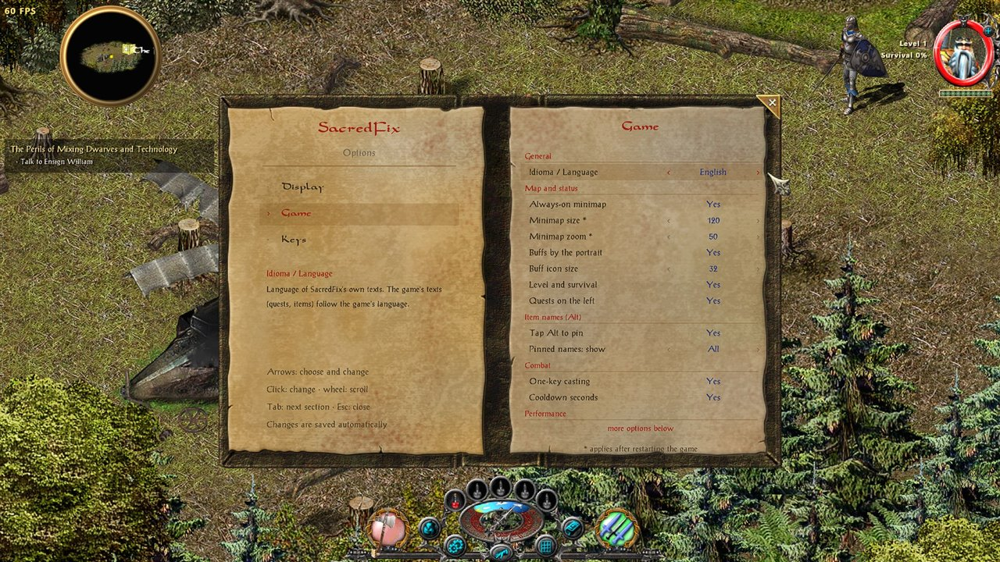

# Ancaria Reforged

**Versión / Version 0.9.0 (beta)** · **Descarga / Download:** [GitHub](https://github.com/jotatwister/Ancaria-Reforged/releases) · [Nexus Mods](https://www.nexusmods.com/sacred/mods/77)

| | |
|---|---|
|  |  |
| Panorámico, minimapa, misiones activas y nivel y supervivencia junto al retrato. *Widescreen, minimap, active quests, level and survival by the portrait.* | Menú F10 con el estilo del libro del juego, aquí en inglés. *F10 menu styled like the game's book, here in English.* |

**[Castellano](#castellano)** · **[English](#english)**

---

## Castellano

Mod para **Sacred Gold** (Steam o GOG, versión 2.0.2.28 en inglés; la de GOG aún sin probar) que se instala como `ddraw.dll` (la DLL se llama SacredFix):
motor gráfico propio (Direct3D 11, con Direct3D 9 de reserva), resolución panorámica, arreglos de compatibilidad y
mejoras de calidad de vida. Escrito en C# (.NET, NativeAOT).

### Qué hace

- **Compatibilidad:** arregla cuelgues y cierres del juego original en Windows modernos (arranque, color de 16 bits,
  modos de vídeo, Alt+Tab, vídeos) y evita que la ventana se minimice al cambiar de programa.
- **Imagen:** panorámico 1366×768, motor Direct3D 11 propio, dibujo a la resolución del monitor, antialiasing,
  filtrado anisótropo, luz por píxel, ajuste de color y modos ventana, sin bordes o pantalla completa.
- **Interfaz:** minimapa siempre visible, buffos activos con su tiempo junto al retrato, segundos de recarga,
  nivel y bonus de supervivencia, misiones activas a la izquierda y nombres de objetos fijos con Alt y filtro por
  calidad.
- **Autocast:** las teclas de las artes (6 a 0) lanzan el arte al momento hacia el cursor, sin tener que
  seleccionarlo y pulsar el botón derecho. Las teclas del juego se pueden reasignar desde el menú.
- **Menú propio (F10)** con el aspecto del libro del juego, en castellano o inglés.

### Lo que aporta Ancaria Reforged

- **Un motor gráfico nuevo.** El juego usaba DirectDraw y Direct3D 7, de 2004. Ancaria Reforged lo traduce todo a
  Direct3D 11 (con Direct3D 9 de reserva) sin modificar ningún archivo del juego.
- **Panorámico.** El juego estaba hecho para 1024×768. Ahora se ve a 1366×768, con más mundo a los lados,
  la interfaz en su sitio y los personajes y objetos bien colocados.
- **Más nítido que nunca.** La imagen se dibuja a la resolución de tu monitor (1080p, 1440p, 4K) con antialiasing,
  sin cambiar lo que se ve.
- **Arreglos de estabilidad.** Cuelgues al arrancar, cierres con Alt+Tab y con los vídeos, el color de
  16 bits en Windows modernos y los bajones de FPS en las ciudades.
- **Información que el juego no da.** Buffos activos con su tiempo, misiones en pantalla, nivel y bonus de
  supervivencia, segundos de recarga y filtros del botín por calidad.
- **Autocast.** Las artes de combate se lanzan con su tecla, sin pasar por el botón derecho.
- **Todo desde el propio juego.** Un menú (F10) con el estilo del libro del juego, en castellano o inglés, que explica
  cada opción.

### Lo que falta

**Por probar**
- Otros equipos y monitores: 4K con escalado de Windows, 16:10, 4:3 y 120/144 Hz, y Windows 7/8.
- Monitores ultrapanorámicos (21:9 y más), que ahora se quedan a 1366 de ancho con bandas.
- Un cuelgue al saltar los vídeos de inicio que se vio dos veces y ya no se reproduce.

**Por crear**
- Recoger el oro automáticamente.
- Que el cursor siga al enemigo atacado.
- Comparar un objeto con el equipado al ver su descripción.
- Abrir el menú también desde el menú de Escape y desde la pantalla de inicio.
- Sustituir texturas por versiones mejoradas.
- Pantalla completa exclusiva con Direct3D 9.

### Compilar e instalar

Requisitos: Windows 10/11, [.NET SDK 9](https://dotnet.microsoft.com/) y Visual Studio 2022 con
«Desarrollo para el escritorio con C++» (NativeAOT para x86 y el compilador de C).

Desde **«x86 Native Tools Command Prompt for VS 2022»**, en la carpeta del repositorio:

```bat
mkdir src\SacredFix\obj
cl /nologo /c /O1 /GS- /Zl /W4 src\SacredFix\Native\early.c /Fosrc\SacredFix\obj\early.obj
set "PATH=%PATH%;%ProgramFiles(x86)%\Microsoft Visual Studio\Installer"
dotnet publish src\SacredFix\SacredFix.csproj -c Release
```

El segundo paso compila el punto de entrada nativo de la DLL (`early.c`); el tercero deja que NativeAOT encuentre
Visual Studio. El resultado es `ddraw.dll`, en la carpeta `publish` dentro de `src\SacredFix\bin`.

Si solo quieres jugar, descarga el mod ya compilado de [GitHub](https://github.com/jotatwister/Ancaria-Reforged/releases) o de [Nexus Mods](https://www.nexusmods.com/sacred/mods/77).

Para instalarlo, copia `ddraw.dll` y `src\SacredFix\SacredFix.ini` en la carpeta de Sacred Gold (donde está
`Sacred.exe`). Para desinstalarlo, borra `ddraw.dll`.

La configuración está en `SacredFix.ini`, junto al juego, y casi toda se cambia en el juego con el menú **F10**.

### Avisos

- Este repositorio **no contiene archivos del juego**. Hace falta una copia legal de Sacred Gold.
- No tiene relación con los autores ni con los editores de Sacred.
- Algunas direcciones del parche panorámico se tomaron como datos de
  [kirides/sacred-bild](https://github.com/kirides/sacred-bild) (GPL-3); no se usa su código.

### Licencia

[GPL-3.0](LICENSE): puedes usar, estudiar, modificar y repartir el mod; si repartes una versión modificada, su
código también tiene que publicarse con GPL-3.0. Se entrega sin garantía de ningún tipo.

---

## English

A mod for **Sacred Gold** (Steam or GOG, English version 2.0.2.28; GOG not tested yet) installed as `ddraw.dll` (the DLL is called SacredFix): its own
renderer (Direct3D 11, with Direct3D 9 as a fallback), widescreen resolution, compatibility fixes and
quality-of-life improvements. Written in C# (.NET, NativeAOT).

### Features

- **Compatibility:** fixes hangs and crashes of the original game on modern Windows (startup, 16-bit colour,
  video modes, Alt+Tab, videos) and keeps the window from minimising when you switch apps.
- **Graphics:** 1366×768 widescreen, custom Direct3D 11 renderer, rendering at your monitor's resolution,
  antialiasing, anisotropic filtering, per-pixel lighting, colour adjustment and windowed, borderless or
  fullscreen modes.
- **Interface:** always-on minimap, active buffs with their remaining time by the portrait, cooldown seconds,
  level and survival bonus, active quests on the left, and pinned item names with Alt with a quality filter.
- **Autocast:** the art keys (6 to 0) cast the art at once towards the cursor, without selecting it and pressing the
  right button. The game's keys can be rebound from the menu.
- **In-game menu (F10)** styled like the game's book, in English or Spanish.

### What Ancaria Reforged brings

- **A brand-new renderer.** The game used DirectDraw and Direct3D 7, from 2004. Ancaria Reforged translates everything
  to Direct3D 11 (with Direct3D 9 as a fallback) without modifying any game file.
- **Widescreen.** The game was made for 1024×768. It now runs at 1366×768, showing more of the world on the
  sides, with the interface in place and characters and objects correctly positioned.
- **Sharper than ever.** The image is rendered at your monitor's resolution (1080p, 1440p, 4K) with antialiasing,
  without changing what you see.
- **Stability fixes.** Hangs at startup, crashes with Alt+Tab and videos, 16-bit colour on modern Windows
  and FPS drops in towns.
- **Information the game doesn't give you.** Active buffs with their remaining time, quests on screen, level and
  survival bonus, cooldown seconds and loot filters by quality.
- **Autocast.** Combat arts are cast with their key, without going through the right button.
- **Everything in game.** A menu (F10) styled like the game's book, in English or Spanish, that explains every option.

### Still to do

**To test**
- Other PCs and monitors: 4K with Windows scaling, 16:10, 4:3 and 120/144 Hz, and Windows 7/8.
- Ultrawide monitors (21:9 and wider), which currently stay at 1366 wide with bars.
- A hang when skipping the intro videos that happened twice and no longer reproduces.

**To build**
- Automatic gold pickup.
- Making the cursor follow the attacked enemy.
- Comparing an item with the equipped one in its tooltip.
- Opening the menu from the Escape menu and the title screen too.
- Replacing textures with improved versions.
- Exclusive fullscreen with Direct3D 9.

### Build and install

Requirements: Windows 10/11, [.NET SDK 9](https://dotnet.microsoft.com/) and Visual Studio 2022 with
"Desktop development with C++" (NativeAOT for x86 and the C compiler).

From the **"x86 Native Tools Command Prompt for VS 2022"**, in the repository folder:

```bat
mkdir src\SacredFix\obj
cl /nologo /c /O1 /GS- /Zl /W4 src\SacredFix\Native\early.c /Fosrc\SacredFix\obj\early.obj
set "PATH=%PATH%;%ProgramFiles(x86)%\Microsoft Visual Studio\Installer"
dotnet publish src\SacredFix\SacredFix.csproj -c Release
```

The second step compiles the DLL's native entry point (`early.c`); the third lets NativeAOT find Visual Studio.
The output is `ddraw.dll`, in the `publish` folder inside `src\SacredFix\bin`.

If you just want to play, download the ready-built mod from [GitHub](https://github.com/jotatwister/Ancaria-Reforged/releases) or [Nexus Mods](https://www.nexusmods.com/sacred/mods/77).

To install it, copy `ddraw.dll` and `src\SacredFix\SacredFix.ini` into the Sacred Gold folder (where `Sacred.exe`
is). To uninstall, delete `ddraw.dll`.

Settings live in `SacredFix.ini`, next to the game, and most of them can be changed in game from the **F10** menu.

### Notes

- This repository **contains no game files**. You need a legal copy of Sacred Gold.
- Not affiliated with the developers or publishers of Sacred.
- Some addresses of the widescreen patch were taken as data from
  [kirides/sacred-bild](https://github.com/kirides/sacred-bild) (GPL-3); none of its code is used.

### License

[GPL-3.0](LICENSE): you may use, study, modify and share the mod; if you share a modified version, its source code
must also be published under GPL-3.0. It comes with no warranty of any kind.
